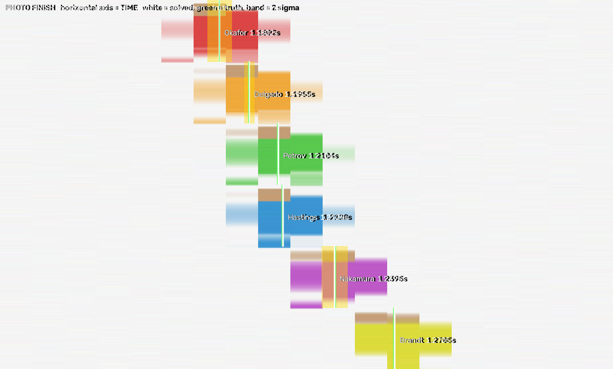
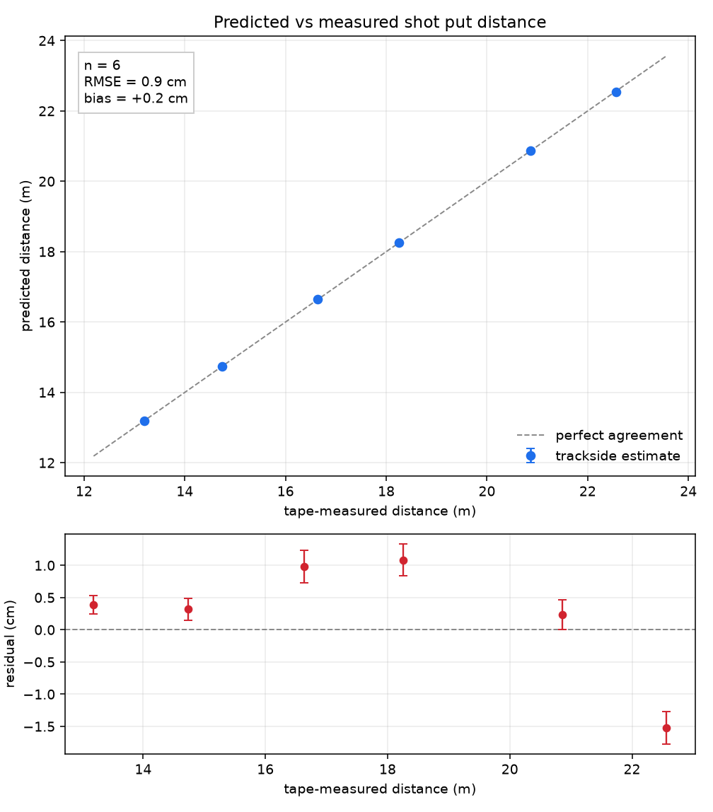

# trackside

**Measure track & field events from a single camera — and report how wrong the measurement might be.**

Two pipelines, one idea:

- **`finish`** — sprint finish timing from ordinary video, resolved far below the frame interval, and honest about margins too close to call.
- **`flight`** — field-event implement tracking through the air: release speed, angle, height, and a predicted distance you can check against the tape measure.

Every quantity comes back as a value **and** an uncertainty. A number without an error bar is not a measurement.

---

## Why this exists

Sports computer vision demos report measurements the way a radar gun would: `41.2 km/h`, `within 4 m`, `12.4 m/s`. Almost none of them report how wrong those numbers could be, and the honest answer is often "quite".

Published academic work on monocular speed estimation reports mean absolute percentage errors [above 20%](https://isprs-annals.copernicus.org/articles/V-2-2020/419/2020/). An entire ICCV paper exists because [the homography scale factor is hard to pin down](https://openaccess.thecvf.com/content/ICCV2021/papers/Revaud_Robust_Automatic_Monocular_Vehicle_Speed_Estimation_for_Traffic_Surveillance_ICCV_2021_paper.pdf). Meanwhile the free tool coaches actually use, [Kinovea](https://kinovea.readthedocs.io/en/latest/tracking/tracking.html), is semi-automatic and reports no uncertainty at all, and the lab alternatives are proprietary.

Throws are an unusually good place to fix this, because **the ground truth is free and exact**. Every throw in every practice gets measured with a tape. So a predicted distance is a falsifiable claim, checked against a physical measurement, at zero cost, in unlimited quantity.

## Results

Both pipelines are validated against synthetic scenes where every answer is known to machine precision. The renderer is deliberately unkind: sub-pixel motion, motion blur from a finite exposure, sensor noise, and a moving distractor. **The analysis never sees the ground truth.**

Reproduce everything with `python demo.py`.

### Sprint finish

| | |
|---|---|
| Frame interval | 16.67 ms (60 fps) |
| Worst timing error | **0.58 ms** |
| Effective resolution | **29× finer than the frame rate** |
| Finishing order | correct, including a 2.4 ms margin |



The horizontal axis is *time*, not space. White is the solved crossing instant, green is truth, the band is 2σ. The solved line falls **between** frame columns — that gap is the resolution the frame rate alone cannot give you.

### Field event

| Quantity | Measured | Truth | Error |
|---|---|---|---|
| Release speed | 12.998 ± 0.001 m/s | 13.000 | −0.02% |
| Release angle | 36.93 ± 0.00° | 37.00 | −0.18% |
| Release height | 2.065 ± 0.000 m | 2.050 | +0.74% |
| **Distance** | **18.845 ± 0.002 m** | **18.840** | **+0.02%** |

Across a sweep of 6 throws spanning 13.2 m to 22.6 m: **RMSE 0.9 cm, bias +0.2 cm, worst case 1.5 cm.**




219 of 709 detections were kept. The swaying thrower is rejected on *ballistic consistency* alone — not size, not speed. Only the real projectile has constant horizontal velocity and constant downward acceleration at the same time.

**Read the residual panel carefully, because it does not fully vindicate us.** The residuals span +1.1 to −1.5 cm while the plotted error bars are around ±0.2 cm, and they show *structure* — positive through the middle of the range, negative at the top. So the uncertainty is still optimistic by roughly 5×, and a small model bias survives the drag correction. Quantifying that residual term is the top open item. A repo about honest error bars does not get to hide its own.

---

## The two ideas worth stealing

### 1. Gravity audits your calibration

Fitting the flight parabola freely recovers **gravitational acceleration** as a by-product. We already know what g is — so the recovered value is a free, independent audit of the entire measurement chain.

In the demo we deliberately mis-click the calibration circle by 1.7 px. Watch it get caught:

```
ring calibration (hand-clicked, 1.7 px off) : 11.355 ± 0.124 mm/px
gravity calibration (from flight curvature) : 11.467 ± 0.001 mm/px
true scale                                  : 11.458 mm/px

recovered g using the ruler: 9.711 ± 0.105 m/s²  (true 9.807)
```

A 0.90% scale error surfaces as a 0.98% error in g. **A bad ruler cannot hide, because it breaks physics.**

### 2. That relationship runs backwards

The pixel curvature of a projectile is `g / (2 · mpp)`. So the video can calibrate its **own scale from gravity**, with no reference object in frame at all — and in practice it beats a hand-clicked ruler by an order of magnitude (0.07% vs 0.90% here).

The cost is real and stated in the code: once g is an *input*, recovering it is circular. **You get the ruler-free measurement or the independent check, not both.**

### Free rulers

World Athletics fixes the throwing circle at **2.135 m** (shot/hammer) and **2.50 m** (discus), and the stop board at 1.21 m. The scale reference is cast into the concrete of every legal venue on earth. No checkerboard, no calibration target — you just have to know which circle you're standing in.

---

## Systematics we found and fixed

Precision is easy. Accuracy is the hard part, and both pipelines initially reported error bars far tighter than their true error. Both causes were systematic, not noise — and averaging more frames would never have removed either.

**Shutter timing bias (finish).** A camera integrating over a finite exposure records the athlete's *average* position across that window, so a frame's true timestamp is the middle of the exposure, not its start. Ignoring this biased every time by **−4.6 ms** — half the exposure — while the reported uncertainty was ±0.5 ms.

The fix has a nice property: the offset is common to every lane, so it **cancels exactly in a margin**. It corrupts absolute times and leaves the race result untouched. So `separations()` uses the statistical term only, and refusing to call a race on a common-mode offset would be its own kind of wrong. If you don't know your shutter, we treat the offset as unknown within one frame interval and widen the absolute error bar instead of quietly reporting a biased number.

**Drag-free fitting bias (flight).** We fit a straight line to x(t), but drag makes horizontal velocity decay — so the fitted slope is the flight's *average* horizontal speed, not its release speed. Correcting it by forward modelling (simulate a dragged flight with the estimated parameters, fit it with the same drag-free model, measure the gap) took distance error from **−0.59% to +0.02%**.

**Stride-correlated residuals (finish).** `polyfit`'s covariance assumes independent residuals, but a runner's blob centroid wobbles *with stride*. The effective sample size is nearer the number of stride cycles than the number of frames, so the naive √n made the timing look ~10× more certain than it was.

**Still open (flight).** The distance error bars remain ~5× tighter than the observed residual scatter, and the residuals are structured rather than random. Something systematic is left — most likely the drag-bias correction being only first-order, plus motion blur pulling the centroid of a fast-moving implement asymmetrically. Until that is nailed down, treat the flight uncertainties as a *lower bound*.

---

## Install

```bash
git clone https://github.com/<you>/trackside && cd trackside
uv venv --python python3.11 && uv pip install -e .
python demo.py
```

## Use

```python
from trackside import PlaneCalibration, analyse_flight, analyse_finish
from trackside.synth import load_frames

frames, _ = load_frames("my_throw.mp4")

# Calibrate off the regulation circle: click its two edges in any frame.
cal = PlaneCalibration.from_circle(pixel_diameter=186.0, event="shot", sigma_pixel=2.0)

res = analyse_flight(frames, cal, fps=120.0, ground_y_px=1000.0)
print(res.release_speed.format(3))            # 12.998 ± 0.001 m/s
print(res.predicted_distance_with_drag)        # 18.845 ± 0.002 m
print(res.scale_check_passes)                  # does gravity agree with the ruler?
```

```python
res = analyse_finish(frames, finish_x_px=980.0, fps=60.0,
                     meters_per_pixel=0.01, lanes=6,
                     exposure_s=0.010)          # omit if you don't know it

for i, r in enumerate(res.placings, 1):
    print(i, r.name, r.cross_time.format(4))

for s in res.separations():
    if not s["resolvable"]:
        print(f"{s['ahead']} vs {s['behind']}: too close to call")
```

## Scope, honestly

**Shot put only, for now.** Discus and javelin generate aerodynamic *lift* — their flight is not projectile motion, and a predicted-vs-actual comparison there would test an aerodynamic model rather than the tracker. Hammer is ballistic and should work; it is untested.

**Validated on synthetic scenes.** The renderer models sub-pixel motion, motion blur, sensor noise and a distractor, but it is not real footage. Real video adds rolling shutter, lens distortion, cluttered backgrounds, and a thrower who occludes the implement at release. Field validation against tape-measured throws is the next step, and the numbers above should be read as *an upper bound on accuracy*, not a field result.

**The throw must be roughly in the calibrated plane.** Out-of-plane motion is the dominant error term in this measurement — the biomechanics literature has warned about it for decades. `PlaneCalibration` takes `depth_m` / `sigma_depth_m` so it enters the uncertainty budget as a first-class term instead of hiding.

**Detection is classical, not learned.** Median background plus connected components: no training, no GPU, reproducible by anyone who clones the repo. A learned detector would help with clutter, not accuracy — `detect_blobs` is the interface it would slot into.

## Tests

```bash
python -m pytest tests/ -q     # 18 passed
```

The end-to-end tests assert against exact ground truth. One of them deliberately feeds a 10% calibration error and asserts that the gravity audit **fails** — a check that never fails is decoration.

## Licence

MIT
