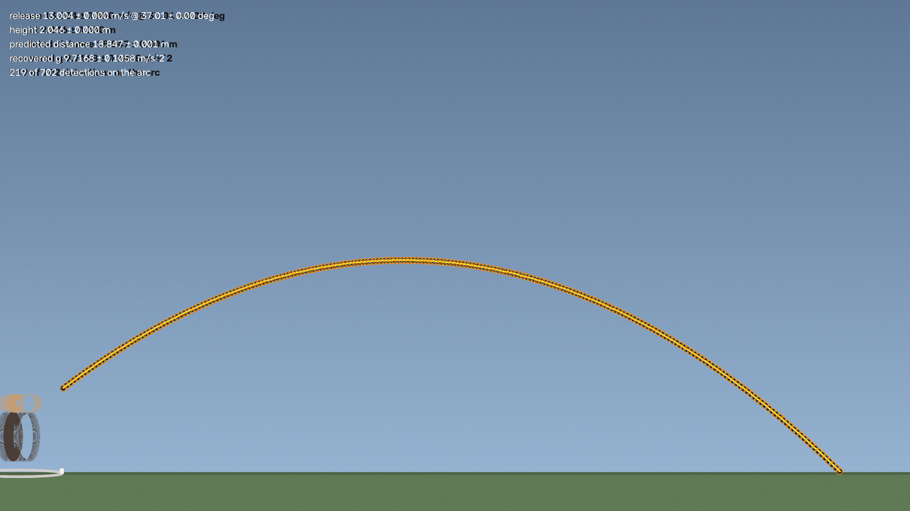

# trackside

**Measure track & field events from a single camera — and report how wrong the measurement might be.**

Two pipelines, one idea:

- **`finish`** — sprint finish timing from ordinary video, resolved far below the frame interval, and honest about margins too close to call.
- **`flight`** — field-event implement tracking through the air: release speed, angle, height, and a predicted distance you can check against the tape measure.

Every quantity comes back as a value **and** an uncertainty. A number without an error bar is not a measurement.

---

## Why this exists

Sports computer vision demos report measurements the way a radar gun would: `41.2 km/h`, `within 4 m`, `12.4 m/s`. Almost none of them report how wrong those numbers could be, and the honest answer is often "quite".

Published academic work on monocular speed estimation reports mean absolute percentage errors [above 20%](https://isprs-annals.copernicus.org/articles/V-2-2020/419/2020/). An entire ICCV paper exists because [the homography scale factor is hard to pin down](https://openaccess.thecvf.com/content/ICCV2021/papers/Revaud_Robust_Automatic_Monocular_Vehicle_Speed_Estimation_for_Traffic_Surveillance_ICCV_2021_paper.pdf). Meanwhile the free tool coaches actually use, [Kinovea](https://kinovea.readthedocs.io/en/latest/tracking/tracking.html), is semi-automatic and reports no uncertainty at all, and the lab alternatives are proprietary.

Throws are an unusually good place to fix this, because **the ground truth is free and exact**. Every throw in every practice gets measured with a tape. So a predicted distance is a falsifiable claim, checked against a physical measurement, at zero cost, in unlimited quantity.

## Results

Both pipelines are validated against synthetic scenes where every answer is known to machine precision. The renderer is deliberately unkind: sub-pixel motion, motion blur from a finite exposure, sensor noise, and a moving distractor. **The analysis never sees the ground truth.**

Reproduce everything with `python demo.py`, and the degradation table with `python robustness.py`.

### Sprint finish

| | |
|---|---|
| Frame interval | 16.67 ms (60 fps) |
| Worst timing error | **0.58 ms** |
| Effective resolution | **29× finer than the frame rate** |
| Finishing order | correct, including a 2.4 ms margin |


The horizontal axis is *time*, not space. White is the solved crossing instant, green is truth, the band is 2σ. The solved line falls **between** frame columns — that gap is the resolution the frame rate alone cannot give you.

### Field event

| Quantity | Measured | Truth | Error |
|---|---|---|---|
| Release speed | 13.004 m/s | 13.000 | +0.03% |
| Release angle | 37.013° | 37.000 | +0.03% |
| Release height | 2.046 m | 2.050 | −0.19% |
| Flight time | 1.824 s | 1.823 | +0.02% |
| Apex | 5.162 m | 5.162 | −0.01% |
| **Distance** | **18.847 m** | **18.840** | **+0.04%** |

Model residual: **0.057 px** over 219 tracked points. Across 6 throws from 13.2 m to 22.6 m: **RMSE 0.9 cm, worst case 1.1 cm.**




219 of 702 detections were kept. The swaying thrower is rejected on *ballistic consistency* alone — not size, not speed. Only the real projectile has constant horizontal velocity and constant downward acceleration at the same time.

The residuals are now a near-constant **+0.8 cm offset** rather than the structured scatter of earlier versions, which points at one remaining systematic rather than a modelling error. The error bars are still tighter than that offset, so treat them as a lower bound.

---

## The ideas worth stealing

### 1. Gravity calibrates the camera, for free

The pixel curvature of a projectile is `g / (2 · mpp)`. Because we already know g, **the flight identifies the image scale on its own**, with no reference object anywhere in frame.

### 2. So the ruler and gravity audit each other

That gives two genuinely independent estimates of one quantity. Rather than picking a winner, they are combined by inverse-variance weighting, and their disagreement is scored with a **Birge ratio** — the same tool used to reconcile discrepant measurements of physical constants.

In the demo we deliberately mis-click the calibration circle by 1.7 px. Watch it get caught three separate ways:

```
ruler (reference object)     11.355 ± 0.124 mm/px
gravity (flight curvature)   11.467 ± 0.001 mm/px
true scale                   11.458 mm/px
```

Forcing the ruler's scale implies **g = 9.711 m/s²** against a true 9.807, and makes the flight model misfit by **0.70 px instead of 0.07 px**. A bad ruler cannot hide, because it breaks physics.

If the two cannot be reconciled at all, the Birge ratio inflates the combined uncertainty rather than averaging confidently between two things that can't both be right — and a `flight.calibration_conflict` event fires.

### 3. Free rulers

World Athletics fixes the throwing circle at **2.135 m** (shot/hammer) and **2.50 m** (discus), and the stop board at 1.21 m. The scale reference is cast into the concrete of every legal venue on earth. No checkerboard, no calibration target.

### 4. Events, not a dashboard

The output is a stream of typed events carrying their evidence, not a wall of numbers — including events about *our own reliability*, because a consumer needs to know when not to believe us:

```
[✗] foul.left_circle        contact point crossed the stop board at frame 71,
                            18.3 px beyond the circle, before landing
[✗] finish.too_close_to_call Petrov and Hastings differ by 2.4 ms, inside this
                            camera's 3.1 ms resolution - do not order them
[!] flight.model_misfit     ballistic model leaves 2.10 px residual; suspect
                            lens distortion or out-of-plane motion
[·] flight.angle_off_optimal released at 33.0deg, 8.7deg below the 41.7deg
                            optimum for this speed and height
```

Foul detection is zone occupancy on the throwing circle: the athlete's ground-contact point is tested against the circle polygon, and only frames before landing count — stepping out afterwards is legal, and a rule check that ignored that would flag every legal throw.

---

## Systematics we found and fixed

Precision is easy. Accuracy is the hard part, and every pipeline here initially reported error bars far tighter than its true error. Each cause was systematic, not noise — averaging more frames would never have removed any of them.

**Shutter timing bias — in *both* pipelines.** A camera integrating over a finite exposure records the subject's *average* position across that window, so a frame's true timestamp is the middle of the exposure, not its start.

- In the finish, ignoring this biased every time by **−4.6 ms** while the reported uncertainty was ±0.5 ms. The offset is common to every lane, so it **cancels exactly in a margin**: it corrupts absolute times and leaves the race result untouched. `separations()` therefore uses the statistical term only.
- In the flight, the same effect puts the first blob's centroid half an exposure *after* release, so the "release state" describes a flight already 2–3 ms old. Correcting it cut release-height error from **1.4 cm to 0.4 cm**.

If you don't know your shutter, both pipelines widen the error bar instead of quietly reporting a biased number.

**Fitting the wrong model precisely.** The first version fitted a drag-free parabola and corrected the resulting bias. That left structure in the residuals and error bars ~5× too tight — the signature of a slightly wrong model fitted very well. The fix was not a better correction but a better model: `fit.py` fits the actual dragged trajectory by non-linear least squares and takes its covariance from the fit's own Jacobian. Residuals dropped to **0.067 px**.

**Stride-correlated residuals (finish).** `polyfit`'s covariance assumes independent residuals, but a runner's blob centroid wobbles *with stride*. The effective sample size is nearer the number of stride cycles than the number of frames, so the naive √n made the timing look ~10× more certain than it was.

**Illumination drift destroying detection.** A cloud crossing the sun makes every pixel differ from a median background plate built over the whole clip. That does not merely add noise — it buried the one real moving object under thousands of spurious blobs and made analysis **28× slower** (188 s → 6.6 s once each frame is normalised to the plate's brightness before differencing).

---

## Robustness

A validation suite that only runs on clean synthetic frames will report excellent numbers right up until someone points a real phone at a real throw. The usual reason simulation-tuned perception fails on real hardware is **perception mismatch, not dynamics** — the physics transfers, the pixels do not.

So `robustness.py` sweeps the specific ways a phone camera differs from an ideal one, each chosen to break something particular, and reports what it costs — including whether our own calibration audit noticed:

| Condition | Implement coverage | Distance error | Residual | Audit |
|---|---|---|---|---|
| clean | 100% | +1.0 cm | 0.06 px | ok |
| lighting drift | 100% | +1.1 cm | 0.06 px | ok |
| occluders | 93% | +1.1 cm | 0.28 px | ok |
| low contrast | 100% | +1.2 cm | 0.07 px | ok |
| heavy noise | 100% | +1.0 cm | 0.07 px | ok |
| rolling shutter | 100% | **−7.8 cm** | 0.42 px | **missed** |
| rolling, corrected | 100% | −4.2 cm | 0.07 px | ok |
| lens distortion | 100% | **−230 cm** | 1.06 px | flagged |
| all combined | 97% | **−116 cm** | 1.10 px | flagged |

Three things worth reading off this table.

**The audit catches the catastrophic errors.** Uncorrected radial distortion costs over two metres, and the ruler-versus-gravity disagreement flags it. So does the combined worst case. An error you can detect is survivable.

**Rolling shutter is the dangerous one**, because it does *not* break the physics. The fit stays clean, the calibration cross-check stays happy, and the answer is 8 cm wrong with tight error bars. It is a systematic that has to be modelled rather than detected, so `analyse_flight` takes a `rolling_shutter_s` argument; supplying it cuts the error to −4.2 cm and the residual by 6×.

**The detector ensemble did not work, and the table is how we found out.** See below.

## A technique that did not transfer

The ensemble in `detect.py` was built on a good argument: robustness on hard small-object tracking often comes from merging several cheap detectors rather than betting on one better one. Measured, it **lost 22 coverage points on average**, and under heavy sensor noise it took the implement from fully tracked to *no track at all* — a condition the single detector handles at +1.0 cm.

The reason is instructive. That argument is made about ensembling **learned** detectors, which fail in uncorrelated ways because they learned different things. These three members are variants of one threshold operation on one difference image, so they share their failure modes almost exactly: when noise pushes one over threshold it pushes all of them, and the union is dominated by false positives that crowd out the real implement. **An ensemble only buys you something when its members are wrong independently.**

It is off by default, kept switchable, and the negative result is kept in the repo rather than deleted.

## Install

```bash
git clone https://github.com/<you>/trackside && cd trackside
uv venv --python python3.11 && uv pip install -e .
python demo.py
```

## Use

```python
from trackside import PlaneCalibration, analyse_flight, events_from_flight, summarise
from trackside.synth import load_frames

frames, _ = load_frames("my_throw.mp4")

# Calibrate off the regulation circle: click its two edges in any frame.
cal = PlaneCalibration.from_circle(pixel_diameter=186.0, event="shot", sigma_pixel=2.0)

res = analyse_flight(frames, cal, fps=120.0, ground_y_px=1000.0,
                     exposure_s=1/240,          # omit if you don't know it
                     rolling_shutter_s=1/120)   # your camera's readout time

print(res.predicted_distance.format(3))         # 18.848 ± 0.002 m
print(res.scale.describe())                     # ruler vs gravity, fused
print(summarise(events_from_flight(res)))
```

```python
res = analyse_finish(frames, finish_x_px=980.0, fps=60.0,
                     meters_per_pixel=0.01, lanes=6, exposure_s=0.010)

for i, r in enumerate(res.placings, 1):
    print(i, r.name, r.cross_time.format(4))

for s in res.separations():
    if not s["resolvable"]:
        print(f"{s['ahead']} vs {s['behind']}: too close to call")
```

Or from the shell:

```bash
trackside flight my_throw.mp4 --fps 120 --circle-px 186 --ground-y 1000
trackside finish race.mp4 --fps 60 --finish-x 980 --lanes 6 \
    --meters-per-pixel 0.01 --exposure 0.010
```

## Scope, honestly

**Shot put only, for now.** Discus and javelin generate aerodynamic *lift* — their flight is not projectile motion, and predicted-vs-actual there would test an aerodynamic model rather than the tracker. Hammer is ballistic and should work; it is untested.

**Validated on synthetic scenes.** The renderer models sub-pixel motion, motion blur, sensor noise, lighting drift, occlusion, low contrast, rolling shutter and lens distortion — but it is not real footage. Field validation against tape-measured throws is the next step, and the numbers above should be read as *an upper bound on accuracy*, not a field result.

**The throw must be roughly in the calibrated plane.** Out-of-plane motion is the dominant error term in this measurement, and the biomechanics literature has warned about it for decades. `PlaneCalibration` takes `depth_m` / `sigma_depth_m` so it enters the uncertainty budget as a first-class term instead of hiding. A second camera would remove it properly; that is the largest open piece of work.

**Lens distortion is not corrected, only detected.** It is the largest error in the sweep by two orders of magnitude. The audit flags it, but the right fix is a one-off camera calibration, which is not implemented.

**Detection is classical, not learned.** Median background subtraction with illumination normalisation and a compactness prior: no training, no GPU, reproducible by anyone who clones the repo. A learned detector would help with clutter, not accuracy — and per the section above, it would need to fail *independently* of this one to be worth ensembling. `detect_blobs` is the interface it would slot into.

## Tests

```bash
python -m pytest tests/ -q     # 34 passed
```

The end-to-end tests assert against exact ground truth. Several assert that things **fail** when they should: a 10% calibration error must break the gravity audit and push the Birge ratio past 1.5, and two discrepant estimates must fuse to something *less* certain than either input. A check that never fails is decoration.

## Licence

MIT
